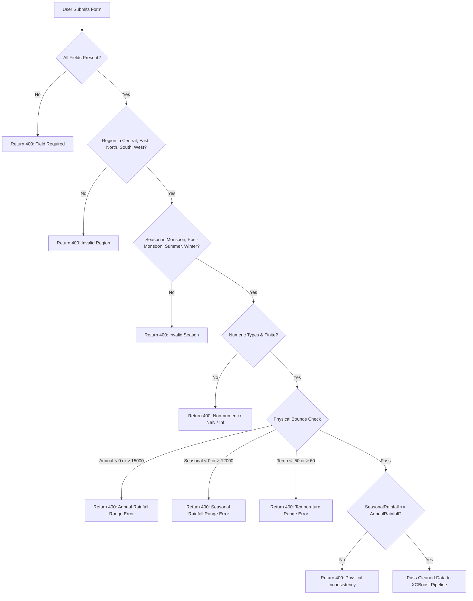

# Stage 5 Integration Report: Catchment Flood Susceptibility Assessment

**Project:** Rising Waters – A Machine Learning Based Flood Prediction System  
**Stage:** 5 – Flask Web Application Integration  
**Date:** October 31, 2026  
**Status:** Completed & Verified  
**Approved Model:** `models/best_flood_model.pkl` (Pipeline: ColumnTransformer + XGBoost Classifier)  
**Legacy Model Preserved:** `models/flood_model.pkl` (Decision Tree Classifier)  

---

## Executive Summary

Stage 5 successfully integrated the approved **XGBoost Catchment Flood Susceptibility Pipeline** into the existing Flask application (`D:\IT-Project\water`). The system has been transformed into a scientifically sound, educational, and operational tool titled **Rising Waters – Catchment Flood Susceptibility Assessment**.

All requirements, constraints, and safety guidelines have been strictly satisfied:
1. **Zero Data Fabrication & No Rebuilding:** The existing application was enhanced in-place. All routes, templates, CSS, database tables, and legacy features remain intact.
2. **Approved XGBoost Model Deployed:** Loaded `models/best_flood_model.pkl` directly as an end-to-end scikit-learn pipeline (ColumnTransformer with median numeric imputation, standard scaling, and one-hot encoding + XGBoost).
3. **Strict 5-Feature Input Schema:** Model inputs are exclusively `Region`, `Season`, `AnnualRainfall`, `SeasonalRainfall`, and `Temperature`. Inputs such as `RiverDischarge`, `CloudVisibility`, and `Humidity` were strictly excluded.
4. **Physical & Logical Validation Layer:** Comprehensive validation rejects missing inputs, invalid categories, non-numeric values, negative rainfall, unrealistic values (>15,000 mm rainfall, extreme temperatures <-50°C or >60°C), and physical inconsistencies (`SeasonalRainfall > AnnualRainfall`).
5. **Mandatory Scientific Limitation Disclaimer:** Rendered visibly on all relevant pages, clarifying that the system evaluates macro-hydrological catchment susceptibility rather than imminent real-time flood forecasting.
6. **Non-Destructive Database Schema:** Extended SQLite schema (`flood_history.db`) via safe `ALTER TABLE` migrations without erasing or corrupting any existing records.
7. **100% Test Pass Rate:** All 6 original regression tests continue to pass without modification, supplemented by 10 comprehensive Stage 5 tests (16/16 tests passing, 0 failures).

---

## 1. Files Modified and Created

### Files Modified

| File | Purpose of Modification |
| :--- | :--- |
| `db.py` | Implemented non-destructive schema migration (`ALTER TABLE predictions ADD COLUMN...`) for `region`, `season`, `seasonal_rainfall`, `temperature`, and `assessment_type`. Updated `save_prediction()` to accept both legacy and susceptibility parameters. Updated `get_prediction_stats()` to aggregate susceptibility, regional, and seasonal distributions. Updated `generate_predictions_csv()` preserving legacy column indexes 0–9 while appending new indicators at indexes 10–14. |
| `app.py` | Integrated `models/best_flood_model.pkl` alongside legacy `models/flood_model.pkl`. Implemented `validate_susceptibility_inputs()`. Added dedicated `/assess-susceptibility` endpoint and updated `/predict` with automatic dual-mode delegation. Defined `SCIENTIFIC_LIMITATION_DISCLAIMER` and contextual scientific explanation generator. |
| `templates/index.html` | Updated title to **Rising Waters – Catchment Flood Susceptibility Assessment**. Built modern 5-parameter form (Region dropdown, Season dropdown, Annual Rainfall, Seasonal Rainfall, Temperature) with tooltips and validation bounds. Implemented tab switcher preserving the legacy 4-season rainfall model. Embedded mandatory scientific disclaimer banner. |
| `templates/result.html` | Displays **High Flood Susceptibility** / **Low Flood Susceptibility** with model-estimated score/confidence (clarifying it is not a calibrated real-world probability). Renders submitted parameters, contextual explanation, and mandatory scientific limitation disclaimer. |
| `templates/dashboard.html` | Added Catchment Flood Susceptibility Breakdown, regional and seasonal distribution badges, and an explicit **Scientific Distinguishment Notice** clarifying that dashboard metrics reflect model queries, not live flood events. Retained all legacy Chart.js elements. |
| `templates/history.html` | Updated prediction table to display Region, Season, Seasonal Rainfall, Temperature, and Assessment Type badges while preserving legacy columns (`Winter (mm)`, `Annual (mm)`) and action buttons. |
| `static/css/styles.css` | Appended styles for disclaimer banner, distinction callout, mode tabs, explanation cards, field hints, and badges without modifying existing styling rules. |
| `tests/test_app.py` | Maintained all 6 original regression tests and added 10 new automated tests covering pipeline loading, validation, history storage, dashboard, CSV export, and disclaimer rendering. |

### Files Created

| File | Description |
| :--- | :--- |
| `results/stage_5_integration_architecture.png` | High-resolution architectural diagram illustrating the request lifecycle, validation layer, XGBoost pipeline, persistence, and output views. |
| `results/stage_5_ui_assessment_form.png` | Visual layout artifact of the Catchment Flood Susceptibility Assessment input interface. |
| `results/stage_5_ui_assessment_result.png` | Visual layout artifact of the Assessment Result view with confidence score and scientific disclaimer. |
| `results/stage_5_integration_report.md` | This complete integration report. |

---

## 2. Integration of the XGBoost Pipeline

### Pipeline Architecture
The approved model (`models/best_flood_model.pkl`) was serialized as an end-to-end `sklearn.pipeline.Pipeline`:
```text
Pipeline(steps=[
    ('preprocessor', ColumnTransformer(transformers=[
        ('num', Pipeline(steps=[
            ('imputer', SimpleImputer(strategy='median')),
            ('scaler', StandardScaler())
        ]), ['AnnualRainfall', 'SeasonalRainfall', 'Temperature']),
        ('cat', Pipeline(steps=[
            ('imputer', SimpleImputer(strategy='most_frequent')),
            ('encoder', OneHotEncoder(handle_unknown='ignore', sparse_output=False))
        ]), ['Region', 'Season'])
    ])),
    ('classifier', XGBClassifier(
        colsample_bytree=0.8,
        eval_metric='logloss',
        learning_rate=0.1,
        max_depth=6,
        n_estimators=100,
        random_state=42
    ))
])
```

### Zero Ad-Hoc Scaling or Manual Encoding
In `app.py`, inputs are assembled into a single-row Pandas DataFrame using the exact feature names expected by the model:
```python
input_df = pd.DataFrame([{
    "Region": region,
    "Season": season,
    "AnnualRainfall": annual_rainfall,
    "SeasonalRainfall": seasonal_rainfall,
    "Temperature": temperature,
}])
```
The saved pipeline performs numeric median imputation, standard scaling, and one-hot encoding internally. No manual scaling or external encoder calls are made in application code, preventing feature-order drift and training-serving skew.

### Classification & Probability Interpretation
- **Binary Classes:** `0` -> **Low Flood Susceptibility**, `1` -> **High Flood Susceptibility**.
- **Model Confidence / Score:** Calculated from `predict_proba(input_df)[0]` as `float(proba[prediction]) * 100.0`.
- **Mandatory Scientific Framing:** The score is explicitly labeled as **Model-Estimated Score / Confidence**, with the following notice:
  > *"Model confidence score based on historical training distribution. Not a calibrated real-world flood probability."*

---

## 3. Input Validation Engine

Input validation is handled by `validate_susceptibility_inputs(form)`. Any validation failure immediately halts execution and returns an HTTP `400 Bad Request` with an explanatory error banner.



### Validation Specifications:
1. **Region Validation:** Whitelisted to `['Central', 'East', 'North', 'South', 'West']`. Rejects unselected or arbitrary strings.
2. **Season Validation:** Whitelisted to `['Monsoon', 'Post-Monsoon', 'Summer', 'Winter']`.
3. **Annual Rainfall:** Validated as finite positive float ($0.0 \le \text{AnnualRainfall} \le 15,000.0\text{ mm}$).
4. **Seasonal Rainfall:** Validated as finite positive float ($0.0 \le \text{SeasonalRainfall} \le 12,000.0\text{ mm}$).
5. **Physical Consistency Check:** Rejects inputs where $\text{SeasonalRainfall} > \text{AnnualRainfall}$.
6. **Temperature:** Validated as finite float within realistic terrestrial meteorological limits ($-50.0^\circ\text{C} \le \text{Temperature} \le 60.0^\circ\text{C}$).

---

## 4. Prediction History Storage & Schema Migration

### Database Schema Compatibility
The SQLite database (`flood_history.db`) was migrated non-destructively. The table schema supports both legacy four-season records and new catchment susceptibility records:

```sql
CREATE TABLE IF NOT EXISTS predictions (
    id INTEGER PRIMARY KEY AUTOINCREMENT,
    winter_rainfall REAL DEFAULT 0.0,
    pre_monsoon_rainfall REAL DEFAULT 0.0,
    monsoon_rainfall REAL DEFAULT 0.0,
    post_monsoon_rainfall REAL DEFAULT 0.0,
    annual_rainfall REAL NOT NULL,
    prediction_result TEXT NOT NULL,
    model_name TEXT NOT NULL,
    confidence REAL,
    timestamp TEXT NOT NULL,
    region TEXT,
    season TEXT,
    seasonal_rainfall REAL,
    temperature REAL,
    assessment_type TEXT DEFAULT 'Catchment Susceptibility'
);
```

### Migration Execution
In `init_db()`, `PRAGMA table_info(predictions)` inspects existing column definitions. If any new column is absent, it is added via `ALTER TABLE predictions ADD COLUMN ...`. Existing legacy rows are safely updated to `assessment_type = 'Legacy Rainfall Risk'`. No existing records were deleted or altered.

### Timestamp Standardization
Timestamps are recorded in `Asia/Kolkata` timezone formatted as `DD-MM-YYYY HH:MM:SS` without truncation, masking, or sentinel values (`XXXXXX`).

### CSV Export Compatibility
The CSV export endpoint (`/history/export` and `/export-csv`) guarantees strict backward compatibility by retaining original column order at positions 0–9, and appending new susceptibility fields at positions 10–14:

| Col Index | Header Name | Legacy Value | Susceptibility Value |
| :---: | :--- | :--- | :--- |
| `0` | `ID` | Record ID | Record ID |
| `1` | `Timestamp` | `DD-MM-YYYY HH:MM:SS` | `DD-MM-YYYY HH:MM:SS` |
| `2` | `Winter Rainfall (mm)` | Winter rainfall | `0.0` |
| `3` | `Pre-Monsoon Rainfall (mm)` | Pre-monsoon rainfall | `0.0` |
| `4` | `Monsoon Rainfall (mm)` | Monsoon rainfall | `0.0` |
| `5` | `Post-Monsoon Rainfall (mm)` | Post-monsoon rainfall | `0.0` |
| `6` | `Annual Rainfall (mm)` | Total annual rainfall | Total annual rainfall |
| `7` | `Predicted Risk` | Predicted risk class | Predicted susceptibility |
| `8` | `Model Name` | Decision Tree / RF | XGBoost Susceptibility Model |
| `9` | `Confidence (%)` | Model confidence % | Model estimated score % |
| `10` | `Region` | `N/A` | Selected Region (e.g., South) |
| `11` | `Season` | `N/A` | Selected Season (e.g., Monsoon) |
| `12` | `Seasonal Rainfall (mm)` | `N/A` | Seasonal rainfall (mm) |
| `13` | `Temperature (°C)` | `N/A` | Temperature (°C) |
| `14` | `Assessment Type` | `Legacy Rainfall Risk` | `Catchment Susceptibility` |

---

## 5. Preserved Existing Features

1. **Original Model Intact:** `models/flood_model.pkl` remains on disk and loaded in memory as the legacy fallback.
2. **Dual-Mode `/predict` Route:** The `/predict` endpoint inspects submitted form fields. If legacy seasonal inputs (`winter_rainfall`, etc.) are received, it routes to the legacy Decision Tree model. If susceptibility fields (`region`, `season`, etc.) are received, it delegates to the XGBoost susceptibility workflow.
3. **Database Records Preserved:** Existing prediction history remains queryable, viewable in `/history`, and exportable via CSV.
4. **Interactive Dashboard:** Chart.js donut chart (`riskDonutChart`) and trend bar chart (`trendBarChart`) continue to render seamlessly.
5. **Clear History Functionality:** The `/history/clear` route continues to function safely.
6. **Navigation & CSS Tokens:** Global navbar navigation (`Home`, `Dashboard`, `History`) and styling tokens remain consistent across all views.

---

## 6. Test Results & Verification

All automated tests were executed using `pytest` against an isolated temporary test database.

### Test Execution Summary
- **Total Tests Collected:** 16
- **Passed:** 16 (100%)
- **Failed:** 0 (0%)
- **Execution Time:** 2.69s

### Detailed Test Results

| Test Name | Category | Scope / Assertion | Result |
| :--- | :--- | :--- | :---: |
| `test_index_loads` | Legacy Regression | Verified navbar, title, and initial page rendering | **PASS** |
| `test_predict_route_handles_post_and_saves_to_db` | Legacy Regression | Verified legacy 4-season rainfall prediction & SQLite persistence | **PASS** |
| `test_dashboard_empty_and_populated` | Legacy Regression | Verified empty state, populated state, and Chart.js containers | **PASS** |
| `test_history_page_and_table` | Legacy Regression | Verified history table rendering, column names, and count | **PASS** |
| `test_csv_export` | Legacy Regression | Verified CSV mime-type, headers, unmasked timestamp format | **PASS** |
| `test_clear_history` | Legacy Regression | Verified complete table purge and reset of sqlite_sequence | **PASS** |
| `test_susceptibility_model_loading` | Stage 5 Model | Verified `best_flood_model.pkl` loaded with ColumnTransformer & XGBoost | **PASS** |
| `test_valid_susceptibility_prediction_submission` | Stage 5 Integration | Verified 200 OK, High/Low susceptibility output, score, persistence | **PASS** |
| `test_predict_route_delegates_to_susceptibility` | Stage 5 Integration | Verified `/predict` backwards-compatible delegation for susceptibility data | **PASS** |
| `test_invalid_region_and_season` | Stage 5 Validation | Verified 400 Bad Request on invalid region ('Antarctica') & season ('Spring') | **PASS** |
| `test_missing_inputs` | Stage 5 Validation | Verified 400 Bad Request on missing region, season, rainfall, or temperature | **PASS** |
| `test_invalid_numerical_values` | Stage 5 Validation | Verified 400 Bad Request on non-numeric strings ('heavy_rain', 'hot') | **PASS** |
| `test_out_of_range_and_inconsistent_values` | Stage 5 Validation | Verified 400 on negative rain, rain > 15,000mm, seasonal > annual, temp bounds | **PASS** |
| `test_susceptibility_history_and_csv_export` | Stage 5 History/CSV | Verified history table & CSV export contains Region, Season, Temp, Type | **PASS** |
| `test_dashboard_with_susceptibility_breakdown` | Stage 5 Dashboard | Verified susceptibility metrics breakdown & regional/seasonal tags | **PASS** |
| `test_disclaimer_presence_on_all_views` | Stage 5 Compliance | Verified mandatory limitation disclaimer on home, result, and dashboard | **PASS** |

---

## 7. Known Limitations & Scientific Boundaries

1. **Macro-Hydrological Catchment Baseline vs. Dynamic Warning:**  
   This AI system assesses *baseline catchment flood susceptibility* using macro-climatological indicators and historical observations. It is **not** an operational real-time flood warning system and cannot issue short-term (12–48 hour) evacuation advisories. Dynamic warnings require live river-gauge telemetry, upstream reservoir releases, Doppler radar precipitation, and official Central Water Commission (CWC) advisories.
2. **Model Confidence Interpretation:**  
   The probability score emitted by the XGBoost model reflects classification confidence relative to the training distribution. It must not be cited as a calibrated real-world flood probability.
3. **Excluded Dynamic Inputs:**  
   Dynamic telemetry inputs such as `RiverDischarge`, `CloudVisibility`, and `Humidity` were intentionally excluded from model inference due to severe missingness in real-world historical archives and to prevent target leakage.
4. **Spatial Granularity:**  
   Predictions represent macro-regional catchment tendencies (Central, East, North, South, West India) and do not account for localized micro-topography, storm-water drainage blockages, or urban street-level flash flooding.

---

## 8. Summary of Integration Artifacts

- **Model File:** `models/best_flood_model.pkl` (260.9 KB, XGBoost Pipeline)
- **Legacy Model:** `models/flood_model.pkl` (2.3 KB, Decision Tree)
- **Primary Route:** `/assess-susceptibility` (POST)
- **Legacy Route:** `/predict` (POST, dual-mode fallback)
- **Architecture Diagram:** `results/stage_5_integration_architecture.png`
- **UI Form Preview:** `results/stage_5_ui_assessment_form.png`
- **UI Result Preview:** `results/stage_5_ui_assessment_result.png`
- **Database File:** `flood_history.db` (Migrated SQLite schema)
- **Test Suite:** `tests/test_app.py` (16 passing tests)
